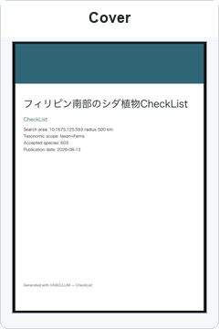
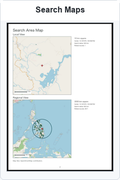
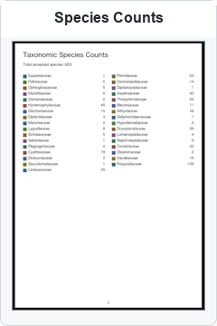
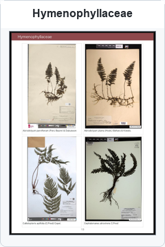
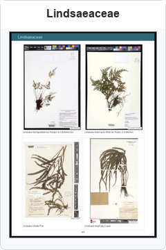
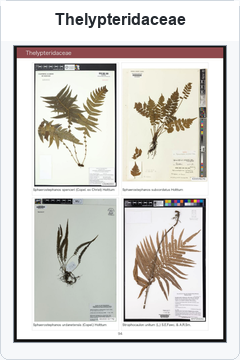
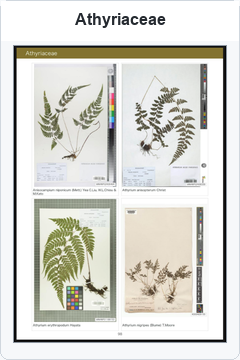
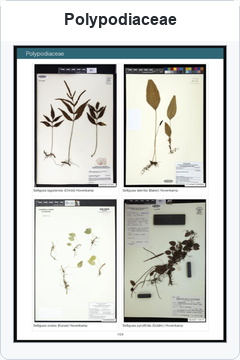
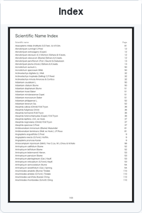

# VASCULUM

Collect herbarium specimen records and photographs from public databases and
build visual checklists, so that occurrence data stay linked to the specimens
behind them.

Version: `v0.1.18` · [Changelog](CHANGELOG.md) · [How to cite](#citation)

*VASCULUM* is the botanist's field collecting case; here it is a virtual one
(Voucher Archive Search and Curation for Unified Large-scale Use of Metadata).

## Pipelines

| Directory | What it does | Main output |
| --- | --- | --- |
| [`herbarium_specimen_collector/`](herbarium_specimen_collector/README.md) | Searches GBIF, CVH and 20+ herbarium portals by scientific name, merges duplicates of the same specimen and downloads the specimen photos | `dwc.csv`, `images/` |
| [`checklist/`](checklist/README.md) | Lists the species of a country or a circle around a point and renders an illustrated checklist PDF | checklist PDF |

After collecting, look at the photos and mark misidentified specimens by
renaming a photo with a `miss_` prefix. The LLM georeference curator of
earlier versions has been removed (see the [changelog](CHANGELOG.md)); coordinates
in the DwC exports are those supplied by the portals.

## Requirements

- macOS (the collector and checklist also run on Linux)
- Python 3.9 or newer
- For the checklist: Codex CLI access, used to pick representative specimen
  images (see the [checklist README](checklist/README.md))

## Installation

Download `VASCULUM-v0.1.18.zip` from
[GitHub Releases](https://github.com/yoneoka-katsuhiro/VASCULUM/releases) and unzip it, or clone the repository. Then:

```bash
cd VASCULUM
bash setup_mac.sh
```

Setup creates a separate Python environment for each pipeline and finishes with
the offline test suite
(`Release checks passed: … tests`). Nothing is sent to external services.

## Quick start

Collect the specimens of one species (the first run asks for a contact email,
which is sent to the portals as polite identification):

```bash
cd herbarium_specimen_collector
bash run_collect_specimens.sh --taxon "Haplopteris mediosora" --synonym "Vittaria mediosora"
```

This writes `dwc.csv`, `dwc.tsv`, `summary.txt` and `images/` to
`herbarium_specimen_collector/output/Haplopteris_mediosora/`. Each pipeline
README explains its options.

## Checklist example

A southern Philippines fern checklist (603 species; 4 h 14 min on a Mac mini).
Scroll sideways and click a page to enlarge it.

<table>
  <tr>
    <td width="240" align="center" valign="top"><a href=".github/assets/checklist-gallery/philippines_fern_checklist_cover.png"></a></td>
    <td width="240" align="center" valign="top"><a href=".github/assets/checklist-gallery/philippines_fern_checklist_search_maps.png"></a></td>
    <td width="240" align="center" valign="top"><a href=".github/assets/checklist-gallery/philippines_fern_checklist_species_counts.png"></a></td>
    <td width="240" align="center" valign="top"><a href=".github/assets/checklist-gallery/philippines_fern_checklist_hymenophyllaceae.png"></a></td>
    <td width="240" align="center" valign="top"><a href=".github/assets/checklist-gallery/philippines_fern_checklist_lindsaeaceae.png"></a></td>
    <td width="240" align="center" valign="top"><a href=".github/assets/checklist-gallery/philippines_fern_checklist_thelypteridaceae.png"></a></td>
    <td width="240" align="center" valign="top"><a href=".github/assets/checklist-gallery/philippines_fern_checklist_athyriaceae.png"></a></td>
    <td width="240" align="center" valign="top"><a href=".github/assets/checklist-gallery/philippines_fern_checklist_polypodiaceae.png"></a></td>
    <td width="240" align="center" valign="top"><a href=".github/assets/checklist-gallery/philippines_fern_checklist_index.png"></a></td>
  </tr>
</table>

## Data sources

The portals and services used are listed in [CITATIONS.md](CITATIONS.md). Cite
the herbaria and datasets behind the records you use, not only this software;
the DwC exports keep each record's institution, dataset and licence.

## Limits

- Records and coordinates are taken as supplied by each portal. Coordinate
  precision, datum and georeferencing provenance are kept in the DwC columns
  when the portal provides them, but are not checked or corrected.
- Portal contents change, so a later run may return different records.

## Development

Run the offline checks before committing or releasing:

```bash
bash check_release.sh
```

GitHub Actions runs the same tests on every push. Generated outputs, caches,
virtual environments and `.env` files are excluded by `.gitignore`.

## Citation

Cite the software with the metadata in [CITATION.cff](CITATION.cff) (GitHub's
"Cite this repository" button), including the version you used, and cite the
data sources as described above.

## License

MIT License; see [LICENSE](LICENSE).
