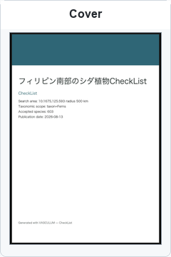
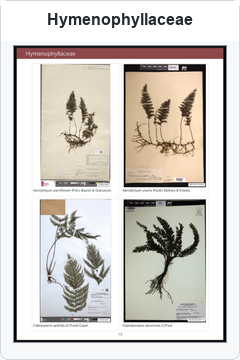
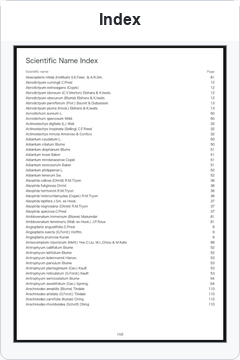

# VASCULUM

**標本を探し、根拠を保ち、写真付きの植物チェックリストを作るツールです。**

[English](README.md) · [日本語マニュアル](docs/MANUAL_JA.md) · [ダウンロード](https://github.com/yoneoka-katsuhiro/VASCULUM/releases/latest) · [変更履歴](CHANGELOG.md)

VASCULUMは、公開標本データベースの記録と写真を収集します。標本収集ツールは、同じ標本の重複記録をまとめ、写真と出典を対応付けたDarwin Core形式の表を出力します。チェックリストツールは、GBIFの地域内記録から種リストを作り、研究者が確認するための写真付きPDFを作成します。

バージョンは **0.1.19** です。VASCULUMという名前は、植物採集用の胴乱に由来します。

## 出力例

以下は、このリポジトリに保存されているフィリピン南部のシダ植物チェックリストの実際のページです。標本写真、学名、参照情報を同じページで確認できます。以前の実行結果を紹介するものであり、今回あらためて標本の同定や分布を検証した結果ではありません。

<p>
<a href=".github/assets/checklist-gallery/philippines_fern_checklist_cover.png"></a>
<a href=".github/assets/checklist-gallery/philippines_fern_checklist_hymenophyllaceae.png"></a>
<a href=".github/assets/checklist-gallery/philippines_fern_checklist_index.png"></a>
</p>

## 目的に合うツールを選ぶ

| ツール | 入力 | 出力 |
| --- | --- | --- |
| `vasculum-collect` | 学名、必要に応じて異名と検索先 | `dwc.csv`、`dwc.tsv`、標本写真、実行概要 |
| `vasculum-checklist` | 国名または円形の検索範囲、分類群 | 種リスト、根拠記録、写真付きPDF |

どちらも**コマンドラインツール**です。macOSではターミナル、WindowsではPowerShellから実行します。標本収集にAIアカウントは不要です。チェックリストの画像選択には、別途インストールしてログインしたCodex CLIが必要です。画像評価の開始前に確認が表示され、利用量に応じて料金が発生する場合があります。AIによる画像の順位付けは、標本の同定を確定するものではありません。

## ダウンロードして試す

[GitHub Releases](https://github.com/yoneoka-katsuhiro/VASCULUM/releases/latest)から、お使いの環境に合うファイルを選んで展開してください。

| 環境 | 配布ファイル |
| --- | --- |
| Apple silicon搭載Mac | `VASCULUM-v0.1.19-macOS-arm64.zip` |
| 64ビットIntel/AMD版Windows | `VASCULUM-v0.1.19-Windows-x64.zip` |
| その他の環境・開発用 | ソースコード。Python 3.11以上が必要 |

実行ファイルにはPythonと必要なPythonライブラリを含めています。Codex CLIは別途必要です。Appleの公証とWindowsの発行者証明書による署名は行っていません。展開、チェックサムの確認、OSの起動警告への対応は、[日本語マニュアル](docs/MANUAL_JA.md#インストール)で説明しています。

展開先をターミナルで開き、まず通信を行わずに設定を確認します。メールアドレスは、ご自身の連絡先に置き換えてください。

```bash
# macOS
./vasculum-collect --dry-run --taxon "Haplopteris mediosora" --contact-email "you@example.org"
```

```powershell
# Windows PowerShell
.\vasculum-collect.exe --dry-run --taxon "Haplopteris mediosora" --contact-email "you@example.org"
```

少量のメタデータを試すには、`--dry-run`を外し、`--sources gbif --limit 10 --skip-images`を追加します。実際の取得時には、検索先サービスに送るHTTP User-Agentに連絡先を含めます。研究用の各実行では、`--output "results/mediosora-trial"`など、新しい出力先を指定してください。

## 方法と結果の読み方

- 標本識別子を基に重複を統合します。座標とその出典、画像とその権利情報は、同一の提供記録から保持します。標本庫による番号の再利用や表記の違いは、人による確認が必要です。
- 座標は各データベースの提供値です。本ツールは座標を推定・補正せず、同定や座標精度を保証しません。
- 地域内分布の根拠にはGBIF記録を用います。CVHは代表画像候補の補充に使います。地域外の画像を掲載しても、その地域内に分布する根拠にはなりません。
- 取得上限、未電子化資料、検索先の障害により、種リストは不完全になり得ます。記録がないことは生物学的な不在を意味しません。利用前に概要と終了コード`3`の有無を確認してください。標本収集の部分結果は`dwc.partial.*`と`summary.partial.txt`に別保存し、過去の完了結果を残します。
- 既存写真は初期設定で残します。削除には`--prune-unreferenced-images`の明示指定が必要で、部分失敗時には削除しません。`miss_`で始まる写真は、手動確認の記録として保持します。
- 日付変更線または極を跨ぐ円形検索は、誤った範囲を検索しないようエラーにします。

[監査結果](docs/AUDIT.md)には修正と未検証事項を、[改善案](docs/ROADMAP.md)には今後追加すると有用な機能をまとめています。開発・検証手順は[こちら](docs/BUILDING.md)です。

## 引用とライセンス

ソフトウェアの引用には[CITATION.cff](CITATION.cff)を使い、使用バージョンを記載してください。標本庫とデータセットは[CITATIONS.md](CITATIONS.md)に従って別途引用します。写真の再配布には各画像の利用条件が適用されます。

ソフトウェアのライセンスは[MIT](LICENSE)です。
