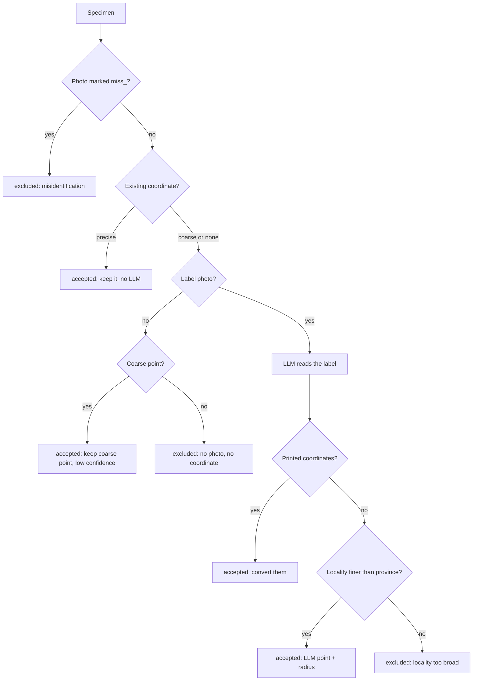

# llm_georeference_curator

Gives every herbarium specimen from `herbarium_specimen_collector` a coordinate
and an uncertainty radius. Precise existing coordinates are kept as they are;
everything else is georeferenced from the collecting label in the specimen
photograph.

Version: `v0.1.17`

## How each specimen is decided



- **Precise** existing coordinate: documented as GPS, or finer than about 1 km
  and not reused by other collecting events.
- **Coarse** existing coordinate: whole arc-minutes or coarser (for example
  `23.51667, 120.8` = 23°31′, 120°48′), or one point shared by specimens with
  different collecting dates. These are regional placeholders, so the label is
  read again. The coarse point is kept only when nothing better is found.
- A partly illegible label is still used: the finest legible place name
  (county, township, village, mountain, river, pass, road) gets a best point and
  a radius that covers the whole named area.

Every accepted record carries `confidence` (high / medium / low) and
`georeferenceVerificationStatus=unverified`. Accepted means "adopted by the
program", not "verified"; you check the final points yourself. Records that
fail for technical reasons (timeouts, provider errors) are marked `failed` and
retried on the next run.

## Requirements

- macOS, Python 3.9 or newer, and [R](https://cran.r-project.org/) (for the summary figure)
- One LLM login, used only for specimens that need a label reading:
  - **ChatGPT** through Codex CLI (default; bundled with the ChatGPT app), or
  - **Claude** through Claude Code CLI (`--llm-provider claude`; bundled with the Claude app)

No API key is needed for either.

## Quick start

From the VASCULUM root, after `bash setup_mac.sh`:

```bash
bash llm_georeference_curator/run_llm_georeference_curator.sh \
  --input herbarium_specimen_collector/output/Haplopteris_mediosora \
  --limit 10
```

Check the ten lines it prints, then drop `--limit 10` for the full run. The
program asks before it spends LLM tokens; add `--yes` to skip the question.

To use Claude Opus instead of Codex, sign in once and add two options:

```bash
claude auth login
bash llm_georeference_curator/run_llm_georeference_curator.sh \
  --input herbarium_specimen_collector/output/Haplopteris_mediosora \
  --llm-provider claude --llm-model opus --limit 10
```

If `claude` is not on your `PATH`, the program finds the copy inside the
Claude desktop app; run `auth login` with that path, which the error message prints.

## What the terminal shows

One line per finished specimen and a single live status line:

```text
VASCULUM georeference v0.1.17 · 10 records
label reading gpt-6.1-sol (medium) · research gpt-6.1-sol (medium, web live) · workers 2
output → llm_georeference_curator/output/Haplopteris_mediosora_georeferenced/
LLM check: Codex CLI logged in (/Applications/ChatGPT.app/.../codex)
    #  specimen      result    conf     radius  basis                time    tok  locality
    1  E01539315     accepted  high     2.0 km  label coords          28s    16k  Myanmar (Burma). Kachin State. Putao Di…
    2  P01189854     accepted  low      2.5 km  label (LLM)         1m58s   168k  Taiwan; NanTou County; JunDa Forest Roa…
    3  P02439185     accepted  med      4.0 km  label (LLM)         1m32s   218k  Taiwan JiaYi County ALiShan mixed fores…
    6  P01187635     accepted  low      2.3 km  existing (coarse)     16s      0  Chinese Taipei
    8  BOTBC122149   excluded  -             -  miss_                  0s      0  Above Panjiasheng along the trail from …
[============--------] 6/10 · 3m40s elapsed · ~2m left · 610k tok · failed 0 · now: P01185529 llm georeference

Done 10 → accepted 8 · excluded 2 · 5m25s · 816k tok
confidence high 1 · medium 1 · low 6 · median radius 3.5 km
files in llm_georeference_curator/output/Haplopteris_mediosora_georeferenced/: modified_dwc.csv/.tsv, ...
```

`basis` says where the point came from: `existing`, `existing GPS`,
`existing (coarse)`, `label coords` (printed on the label), `label (LLM)`
(researched from the label locality). Add `--verbose` to see every processing
stage. When output is redirected to a file, the live status line is left out.

## Outputs

Written to `output/<input_name>_georeferenced/` (or `--output PATH`):

| File | Contents |
| --- | --- |
| `modified_dwc.csv`, `modified_dwc.tsv` | Accepted records only, with coordinate, radius, datum, confidence, sources and remarks |
| `georeference_candidates.tsv` | Every record: label transcription, all candidate points and the decision |
| `summary.txt` | Counts, models, token use, settings and software versions |
| `georeference.log.jsonl` | Full audit trail: prompts, model answers, sources, hashes, before/after coordinates |
| `georeference_flow.pdf` | Ribbon figure of how many records were kept or excluded at each step |

Input tables and photographs are never modified.

## How the uncertainty radius is built

Following the point-radius method (Chapman & Wieczorek 2020), the radius is the
sum of the parts that apply:

| Component | Value |
| --- | --- |
| Rounding of the printed coordinate | from its precision; arc-minute values use ±0.5′, not ±0.05° |
| Positional error not stated by the source | 1000 m |
| Datum not stated (WGS84 assumed) | 1000 m, noted as `datum not stated; assumed WGS84` |
| Named area (township, mountain, …) | radius covering the whole area |
| Area with unknown extent | 50 km, low confidence |

These are stated policy allowances, not measured errors. No upper limit is
applied unless you pass `--max-uncertainty-meters N`, which excludes accepted
points whose radius exceeds N.

## Frequently used options

| Option | Effect |
| --- | --- |
| `--limit N` | Process only the first N records (trial runs) |
| `--yes` | Do not ask before using LLM tokens |
| `--llm-provider claude --llm-model opus` | Use Claude Opus through Claude Code instead of Codex |
| `--llm-reasoning-effort low/medium/high` | Effort for locality research (label reading has `--label-reasoning-effort`) |
| `--max-uncertainty-meters N` | Exclude points with a radius above N metres |
| `--export-images` | Copy photos of accepted specimens to `output/.../images/` |
| `--verbose` | Print every stage instead of one line per specimen |
| `--dry-run` | Check inputs and options without calling an LLM or writing files |

Run `--help` for the full list.

## Your own specimens and identity checks

- **Add specimens:** put `personal/dwc.tsv` (or `.csv`) and/or photos in
  `personal/images/` inside the collector output folder. They are included
  automatically. Photos named `MY1__front.jpg`, `MY1__label.jpg` are grouped as
  one specimen. Other folders can be added with `--additional-input PATH`.
- **Exclude a misidentification:** rename its photo with a `miss_` prefix
  (`P01185529_Taxon.jpg` → `miss_P01185529_Taxon.jpg`). The whole specimen is
  excluded on the next run without an LLM call. Remove the prefix to undo.

## Re-running, caching and interruption

- Rerunning the same command resumes: finished records and LLM answers are
  cached in `.cache/llm_georeference_curator/` and are not paid for twice.
  Failed records are retried.
- After upgrading, copy the old `.cache/llm_georeference_curator/` folder (or
  pass `--llm-cache-dir PATH`) to reuse earlier label readings.
- Ctrl-C stops the whole run, including LLM subprocesses, with exit code 130.
  Finished records stay cached.

Exit codes: 0 success, 1 error, 2 invalid options, 3 finished with some failed
records, 130 interrupted.

## Limitations

- The coordinates have not been compared with an independent ground-truth set,
  so no positional accuracy is claimed. Six decimal places are formatting.
- LLM answers and web pages change over time; a fresh run may not reproduce an
  earlier answer exactly. The cache and log make an existing run auditable.
- Country and province checks use current Natural Earth boundaries, not
  historical ones.

See [docs/methodology.md](docs/methodology.md) for the method in detail. The
approach is inspired by Xie et al. (2025, *Nature Plants* 11:2446–2450) and
follows the point-radius concepts of Chapman & Wieczorek (2020,
*Georeferencing: Best Practices*, GBIF).
